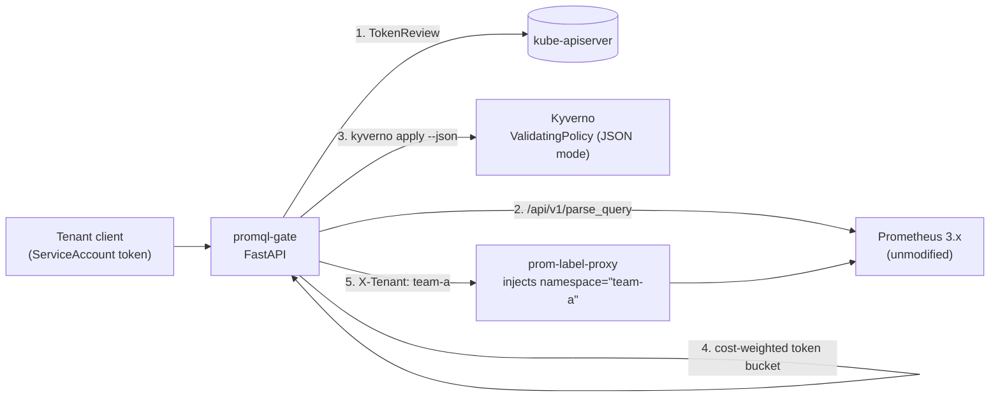

# Least-Privilege Metrics: Securing PromQL in Multi-Tenant Clusters

Companion demo for the PromCon talk. A policy-enforcing query gate in front of an
unmodified Prometheus that treats every PromQL query like a tool call in an agentic
system: authenticate it, understand it, decide on it, budget it, then let it through.



| Step | Who | What it stops |
|---|---|---|
| Authenticate | gate + TokenReview | anonymous access, tenant spoofing |
| Parse | Prometheus' own parser | parser differentials (the gate never re-implements PromQL) |
| Decide | Kyverno policies (`policies/`) | enumeration, sensitive metrics, cross-tenant selectors, expensive shapes |
| Budget | gate (in-memory) | noisy neighbours draining the shared TSDB |
| Rewrite | prom-label-proxy | anything the policy didn't think of: every selector gets `namespace="<tenant>"` |
| Enforce path | NetworkPolicy (`k8s/40-*`) | walking around the gate |

## Quickstart (kind)

Prerequisites: `kind` ≥ v0.24 (kindnet enforces NetworkPolicy), `kubectl`, `helm`, `docker`, `jq`, `curl` ≥ 7.84.

```bash
./setup.sh        # ~3-4 minutes: cluster, Prometheus, kube-state-metrics, tenants, gate
./demo.sh         # press Enter to advance each command
./demo.sh 4       # jump to scene 4
./teardown.sh
```

## Rehearse without a cluster

```bash
pip install -r gate/requirements.txt
# put prometheus, prom-label-proxy and the kyverno CLI on PATH, then:
./hack/local-run.sh &          # wait ~30s for the first scrapes
LOCAL=1 ./demo.sh              # scene 6 (NetworkPolicy) is skipped locally
```

## The policies

| File | Rule |
|---|---|
| `01-no-metric-enumeration` | every selector must name a metric; no `{__name__=~".+"}` |
| `02-sensitive-metric-denylist` | `kube_secret_*`, `kube_configmap_*`, `node_uname_info`, `kube_node_info` denied for everyone |
| `03-tenant-metric-allowlist` | per-tenant metric prefixes; unknown tenants get nothing |
| `04-tenant-isolation` | namespace matchers must be `="<own tenant>"`; no regex, no `!=`, no `exported_namespace` |
| `05-query-cost-limits` | per-tier max window, lookback, subqueries, estimated samples |

The gate hands Kyverno this document for every query (example):

```json
{
  "kind": "PromQLQuery", "endpoint": "/api/v1/query_range", "tenant": "team-b",
  "query": "sum by (route)(rate(http_requests_total[15m]))",
  "metrics": ["http_requests_total"],
  "selectors": [{"metric": "http_requests_total", "matchers": [], "nameMatchers": [...]}],
  "functions": ["rate"], "hasUnnamedSelector": false, "subqueries": 0,
  "maxLookbackSeconds": 900, "windowSeconds": 3600, "stepSeconds": 15,
  "estimatedSamples": 14701
}
```

Test a policy change without the gate:

```bash
echo '{"kind":"PromQLQuery","tenant":"team-b","metrics":["checkout_revenue_total"],"selectors":[],
       "hasUnnamedSelector":false,"subqueries":0,"maxLookbackSeconds":300,"windowSeconds":0,
       "estimatedSamples":10}' > /tmp/q.json
kyverno apply policies/*.yaml --json /tmp/q.json
```

## Repo layout

```
gate/        promql-gate (FastAPI) + Dockerfile (bundles the Kyverno CLI)
policies/    Kyverno ValidatingPolicy, evaluation.mode: JSON
k8s/         Prometheus, tenant apps, gate + prom-label-proxy, NetworkPolicies
apps/        fake-shop: stdlib exporter with customer_id labels worth protecting
hack/        local rehearsal harness
demo.sh      scene-by-scene driver
TALK-NOTES.md  what to say per scene + where the model breaks down
```

## Tested with

Prometheus v3.15.0, prom-label-proxy v0.15.1, Kyverno CLI v1.19.1, Python 3.12.

**This is a demo, not a product.** 
